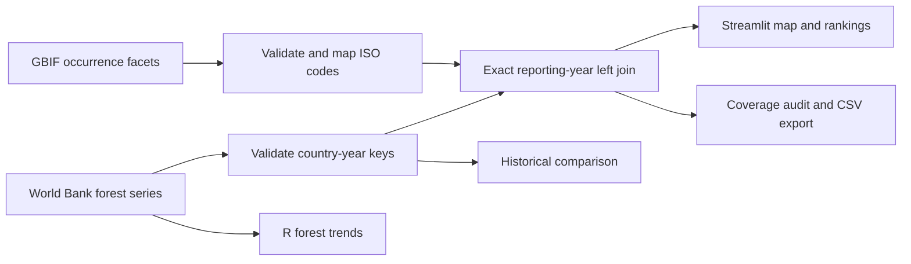

# Forest / Field — Biodiversity & Forest Observatory

A global scientific dashboard for biodiversity reporting effort and forest cover. Four analytical workspaces, map modes and projections, country comparisons, observation methods and data exports. Includes a South Asia R analysis.

## Architecture



## Sources and limitations

- [GBIF occurrence API](https://techdocs.gbif.org/en/openapi/v1/occurrence): separate country, collection-year and basis-of-record facets for georeferenced records without flagged geospatial issues. Configurable collection years 1990–2026. Underlying records have varying CC0, CC BY and CC BY-NC licenses; formal record downloads require appropriate citation. No individual records are redistributed.
- [World Bank forest area](https://data.worldbank.org/indicator/AG.LND.FRST.ZS): country-year forest area as percentage of land, requested 1990–2026. World Bank data generally uses CC BY 4.0 subject to dataset-specific exceptions.
- Actual live counts, date coverage and license applicability have not been independently verified. The application displays retrieved counts and coverage, not invented numbers. Facet rows are aggregate categories, not individual biological observations. This is not a row-level biodiversity research dataset.
- ISO2 to ISO3 conversion excludes unmapped codes. Exact-year forest join preserves missing values. Collection-year windows and forest reporting years differ; no causal inference or population estimate is supported. Sampling effort and reporting bias are material.
- No synthetic analytical data or fallback. Unit fixtures are isolated under tests.

## Run

```bash
pip install -r requirements.txt
streamlit run app.py
python -m pytest -q
```

Docker: `docker build -t forest-field .` then `docker run -p 8501:8501 forest-field`.

R: install jsonlite, dplyr and ggplot2, then run `Rscript r/forest_change.R`. Outputs are observed South Asian forest histories and a chart.

## Release status — 2026-11-25

Source published. CI configured, but its outcome, live ingestion, actual data scale and browser visual QA are pending. No screenshots or production-readiness claims. The design uses a forest palette, top-level controls, KPI cards and four analytical tabs. The aggregate-only GBIF source remains a limitation against the campaign's large row-level data goal.
